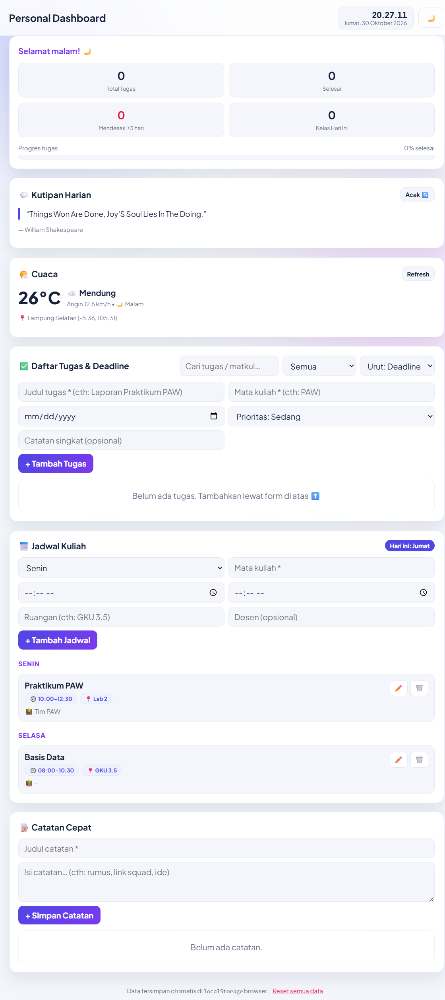

# Personal Dashboard Mahasiswa

**Nama:** Erza Farandi | **NIM:** 124140171 | **Praktikum PAW — Pertemuan 2**

## 1. Penjelasan Aplikasi

Aplikasi personal dashboard untuk kebutuhan spesifik mahasiswa: mengatur **tugas & deadline kuliah**, **jadwal kuliah mingguan**, dan **catatan cepat** dalam satu halaman. Idenya sederhana — daripada memakai tiga aplikasi berbeda, semua kebutuhan organisasi harian mahasiswa (tugas apa yang mendesak, kelas apa hari ini, catatan singkat) tampil sekaligus di satu dashboard, dilengkapi widget **jam real-time**, **cuaca lokasi kampus**, dan **kutipan motivasi harian** dari API publik.

Semua data pengguna tersimpan di `localStorage` browser, sehingga tetap ada setelah halaman di-refresh tanpa perlu backend.

## 2. Fitur-Fitur

| Modul | Fungsi |
|---|---|
| 👋 Sapaan + Jam | Sapaan otomatis (pagi/siang/sore/malam), jam live tiap detik, tanggal bahasa Indonesia, mode gelap/terang yang tersimpan |
| 💬 Kutipan Harian | Diambil acak dari API DummyJSON, tombol Acak, ada kutipan cadangan saat offline |
| 🌤️ Cuaca | Suhu, deskripsi cuaca, kecepatan angin, dan penanda siang/malam dari API Open-Meteo (lokasi Lampung Selatan), tombol Refresh |
| ✅ Tugas & Deadline | Tambah, edit, hapus, centang selesai; badge sisa hari (H-1, H-2) / TERLAMBAT / SELESAI; prioritas rendah–sedang–tinggi; pencarian; filter (semua/belum/selesai/terlambat); pengurutan (deadline/prioritas/terbaru); kartu statistik + progress bar |
| 📅 Jadwal Kuliah | Tambah, edit, hapus (hari, mata kuliah, jam mulai–selesai, ruangan, dosen); dikelompokkan per hari sesuai urutan Senin–Minggu; badge "HARI INI" dan penghitung kelas hari ini |
| 📝 Catatan Cepat | Tambah, edit, hapus, sematkan (pin) catatan penting ke atas, timestamp otomatis |
| 💾 Penyimpanan | Tugas, jadwal, catatan, dan tema tersimpan otomatis di `localStorage`; tombol "Reset semua data" di footer |

Catatan: daftar tugas dimulai dalam keadaan **kosong**. Data contoh lama (dari API simulasi) dibersihkan otomatis satu kali saat aplikasi dibuka. Jadwal terisi 2 contoh bawaan pada kunjungan pertama dan bisa dihapus/diubah bebas.

## 3. Cara Menjalankan

1. Buka folder `Erza Farandi_124140171_pertemuan2` di File Explorer / VS Code.
2. Klik dua kali `index.html` (atau jalankan lewat Live Server / `npx serve .`).
3. Tidak perlu build dan tidak perlu API key — langsung jalan di browser modern.

## 4. Screenshot Antarmuka



> Jika gambar di atas belum tampil, buka `index.html` di browser, ambil tangkapan layar seluruh halaman (misalnya `Win+Shift+S`), lalu simpan sebagai `screenshot.png` di folder ini dengan nama persis tersebut.

## 5. Daftar Fitur ES6+ (file `app.js`)

| Fitur | Lokasi (baris) | Keterangan |
|---|---|---|
| `let` dan `const` tepat | `app.js:9-17` (konstanta `STORAGE_KEYS`, `DAY_ORDER`, `PRIORITY_WEIGHT`); `app.js:240` (`let list` yang di-reassign saat filter); `const` untuk semua nilai tetap, mis. `app.js:112,177,190` | Referensi state tidak diubah sembarangan, yang berubah nilainya memakai `let` |
| Arrow functions (20+) | `app.js:19-34` (helper `$`, `esc`, `uid`, `fmtDate`, `daysUntil`, `showToast`); `app.js:143-156` (callback event listener); `app.js:218,240-249,292,349,392,457-460` (callback `map`/`filter`/`sort`) | Dipakai untuk helper, callback event, dan operasi array |
| Template literals | `app.js:170-179` (render kutipan); `app.js:191-198` (render cuaca); `app.js:257,260-277` (render daftar tugas); `app.js:311,315,321-322` (render jadwal); `app.js:367,371` (render catatan); `app.js:466-467` (progress bar) | Seluruh rendering daftar dinamis memakai backtick + `${}` |
| Fungsi asinkron (`async/await` + `Promise`) | `app.js:160-162` (`loadExternalData` + `Promise.allSettled`); `app.js:165-183` (`fetchQuote`); `app.js:184-206` (`fetchWeather`) | Dua API publik dipanggil paralel; ada penanganan `try/catch` + fallback offline |
| Classes | `app.js:45-66` (`TaskItem`: getter `remaining`/`isOverdue`/`badge` + method `toggle`); `app.js:68-74` (`ScheduleItem`); `app.js:76-82` (`NoteItem`); `app.js:84-492` (`DashboardApp`: state, storage, fetch, render) | Sesuai panduan arsitektur: `TaskItem` memodelkan data, `DashboardApp` mengelola aplikasi |
| Destructuring | `app.js:46,69,77` (parameter constructor); `app.js:169` (`{ quote, author }`); `app.js:177` (`[q, a]`); `app.js:189` (`{ current_weather: w }` + rename); `app.js:241` (`{ title, course }`); `app.js:371` (`{ id, title, body, pinned, createdAt }`); `app.js:390` (`{ action, id }`) | Destructuring objek, array, parameter fungsi, dan rename |
| Spread operator (immutable) | `app.js:219,223` (tambah/ubah tugas); `app.js:251` (sort salinan); `app.js:293,296,312` (jadwal); `app.js:349,352,370` (catatan); `app.js:392,441` (toggle/pin) | Setiap perubahan state menghasilkan array/objek baru (`[...arr]`, `{ ...obj }`) |
| `localStorage` | `app.js:87-93` (muat + bersih data contoh lama); `app.js:106-119` (`load`/`save` + `JSON.parse`/`JSON.stringify`); `app.js:478,484-486` (tema + reset) | Key: `erzaboard_tasks_v1`, `erzaboard_schedules_v1`, `erzaboard_notes_v1`, `erzaboard_theme_v1` |

## 6. API Publik yang Dipakai (gratis, tanpa API key)

1. **Cuaca real-time — Open-Meteo.** `https://api.open-meteo.com/v1/forecast?latitude=-5.36&longitude=105.31&current_weather=true` → widget cuaca Lampung Selatan (`fetchWeather`, `app.js:184`).
2. **Kutipan harian — DummyJSON.** `https://dummyjson.com/quotes/random` → kutipan motivasi acak (`fetchQuote`, `app.js:165`).

## 7. Struktur File

```
Erza Farandi_124140171_pertemuan2/
├── index.html      # struktur UI (sapaan, kutipan, cuaca, tugas, jadwal, catatan)
├── style.css       # tema terang/gelap, kartu, grid responsif
├── app.js          # seluruh logika (OOP + async + localStorage)
├── screenshot.png  # tangkapan layar aplikasi jadi (lihat bagian 4)
└── README.md       # dokumentasi ini
```

## 8. Kerapian Kode

- Satu method satu tanggung jawab (`handleTaskSubmit`, `renderTasks`, `fetchWeather`, …) dengan komentar pembatas per modul.
- Semua input pengguna di-escape lewat `esc()` (`app.js:20`) agar aman dari XSS.
- Event delegation: satu listener global untuk semua tombol aksi di tiga daftar (`app.js:152`, `handleActionClick` di `app.js:387`).
