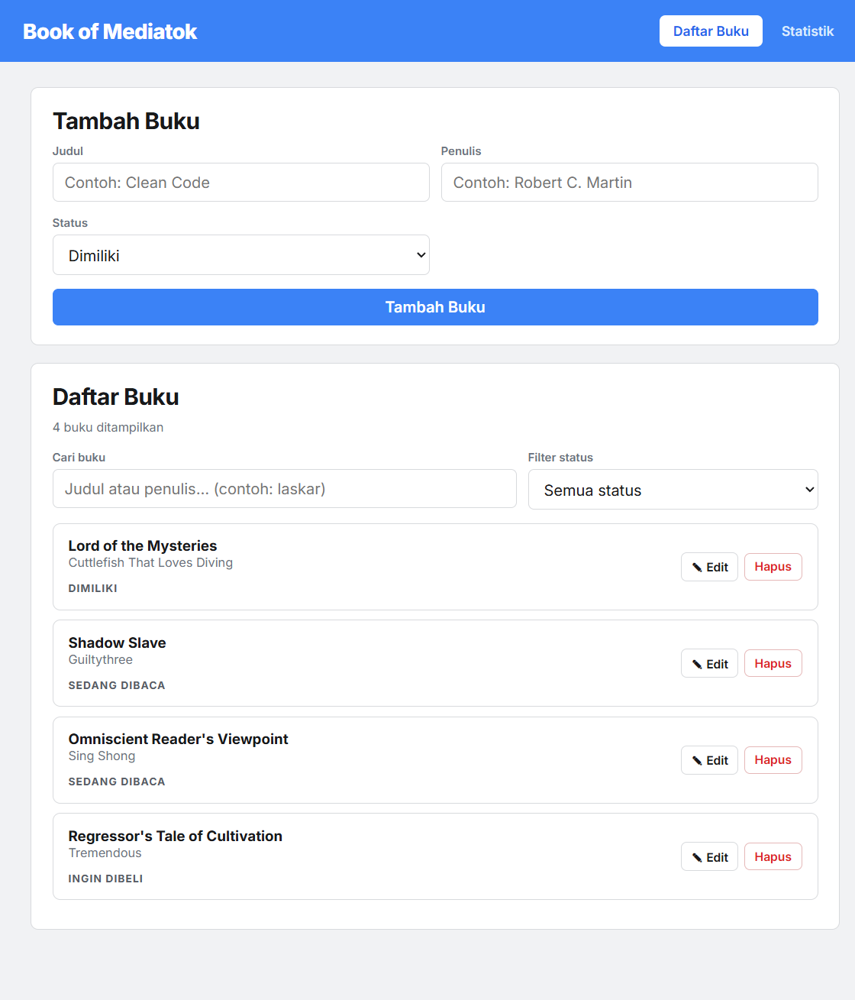
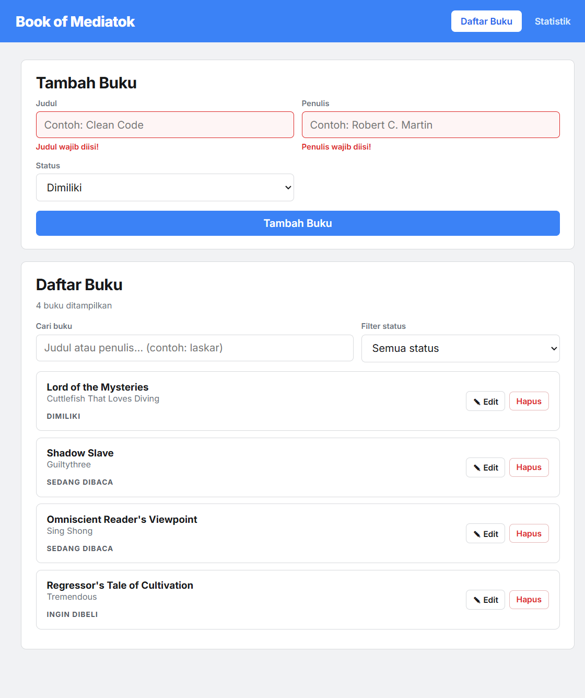
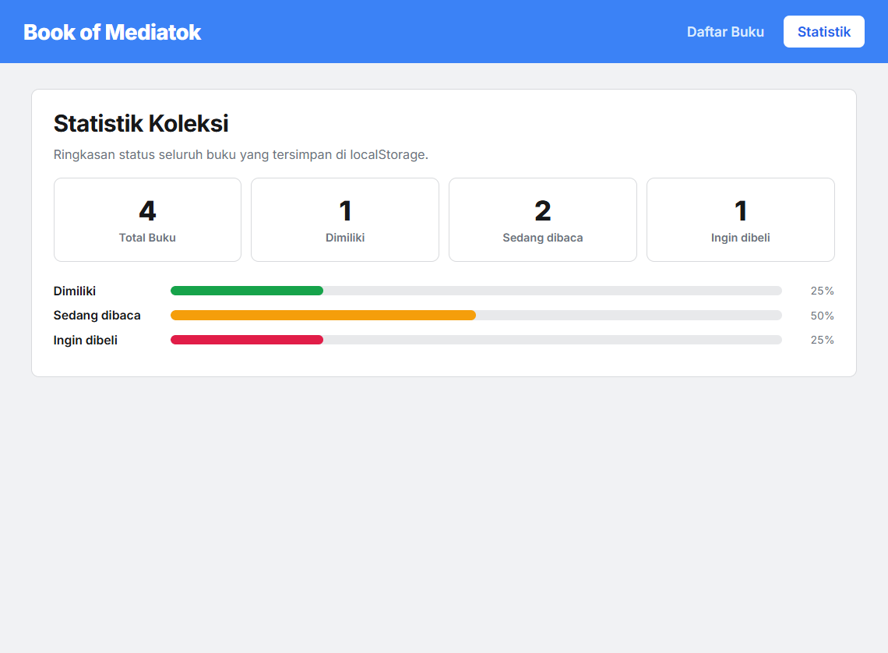
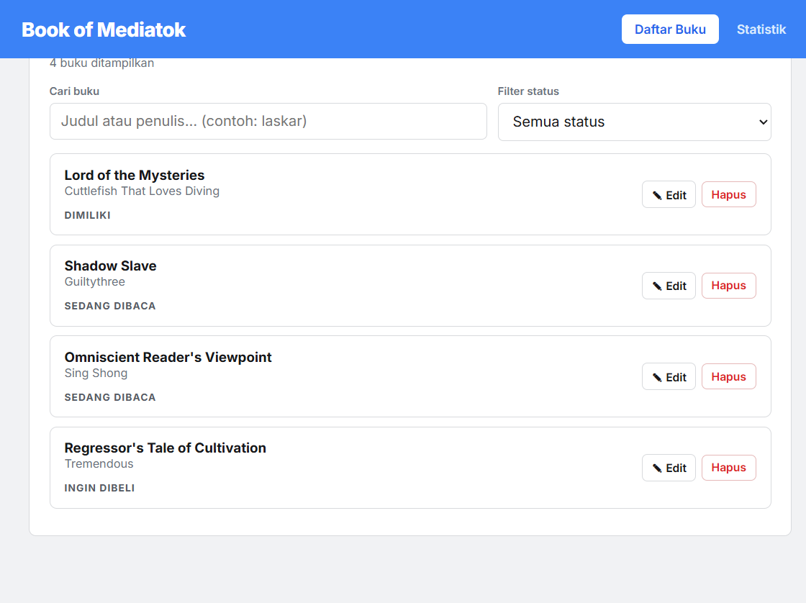
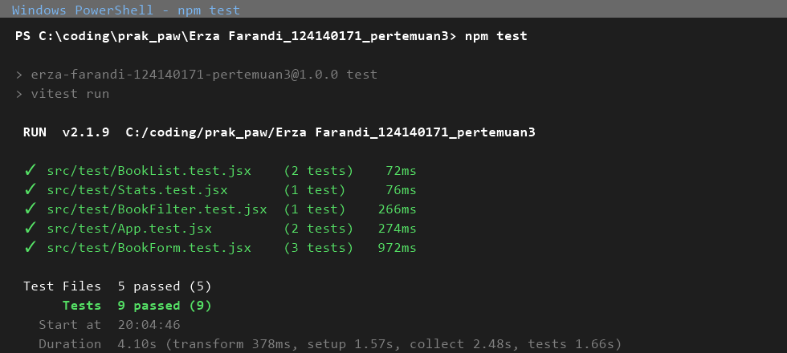

# Book of Mediatok — Aplikasi Manajemen Buku Pribadi

**Erza Farandi — 124140171 — Praktikum PAW Pertemuan 3**

Aplikasi React (Vite) untuk mencatat koleksi buku pribadi dalam tiga status: **dimiliki**, **sedang dibaca**, dan **ingin dibeli** — lengkap dengan filter, pencarian, statistik, dan penyimpanan persisten.

## 1. Deskripsi Aplikasi

| Halaman | Isi |
|---|---|
| `/` (Daftar Buku) | Form **Tambah Buku** yang selalu tampil di atas, lalu daftar semua buku dengan pencarian (judul/penulis), filter per status, serta tombol hapus & edit per buku |
| `/stats` (Statistik) | Jumlah buku per status + progress bar persentase (memakai custom hook `useBookStats`) |
| `/edit/:id` (Edit Buku) | Form edit yang sudah terisi data buku terpilih, kembali ke daftar setelah simpan |

Data tersimpan di `localStorage` (key `bookmania_books_v2`) sehingga tidak hilang saat refresh. Kunjungan pertama diisi 4 buku contoh yang bebas dihapus/ubah.

Navbar bersifat *sticky* (`position: sticky`): tetap terlihat di atas layar walaupun halaman di-scroll.

## 2. Instalasi & Cara Menjalankan

```bash
# masuk folder project
cd "Erza Farandi_124140171_pertemuan3"

# pasang dependensi (termasuk react-router-dom & prop-types)
npm install

# jalankan server development → http://localhost:5173
npm run dev

# jalankan seluruh unit test (Vitest + RTL)
npm test

# build production
npm run build
```

## 3. Screenshot Antarmuka

Tangkapan layar aplikasi berjalan tersimpan di folder `screenshots/`:

| File | Isi |
|---|---|
| `screenshots/home.png` | Halaman daftar buku: form tambah di atas + daftar, filter, pencarian |
| `screenshots/error-validasi.png` | Feedback error saat kolom wajib kosong |
| `screenshots/stats.png` | Halaman statistik |
| `screenshots/navbar-sticky.png` | Navbar tetap terlihat saat halaman di-scroll |
| `screenshots/test.png` | Hasil `npm test` di terminal |

### Halaman Daftar Buku (form tambah + daftar)



### Error Validasi Form



### Halaman Statistik



### Navbar Saat Scroll



### Laporan Testing (`npm test`)



## 4. Struktur Project

```
Erza Farandi_124140171_pertemuan3/
├── public/
│   └── favicon.svg                    # aset statis
├── screenshots/                       # tangkapan layar laporan
├── src/
│   ├── components/
│   │   ├── BookForm/     # reusable: form tambah/edit + validasi wajib isi
│   │   ├── BookList/     # reusable: menampung hasil filter/kosong
│   │   ├── BookCard/     # reusable: kartu 1 buku + aksi edit/hapus
│   │   ├── BookFilter/   # reusable: pencarian + filter status (controlled)
│   │   └── Navbar/       # reusable: navigasi React Router
│   ├── pages/
│   │   ├── Home/         # halaman daftar buku
│   │   ├── Stats/        # halaman statistik
│   │   └── Edit/         # halaman edit /edit/:id
│   ├── hooks/
│   │   ├── useLocalStorage.js   # custom hook #1: state persisten
│   │   └── useBookStats.js      # custom hook #2: hitung statistik (useMemo)
│   ├── context/
│   │   └── BookContext.jsx      # Context API: state global + CRUD buku
│   ├── test/                    # 9 unit test (5 file)
│   ├── main.jsx
│   ├── App.jsx                  # React Router multi-halaman
│   └── index.css
├── .gitignore
├── .oxlintrc.json               # konfigurasi linter (oxlint, jalankan npm run lint)
├── index.html
├── package.json / package-lock.json
├── vite.config.js               # konfigurasi Vite + Vitest
└── README.md
```

## 5. Penjelasan Fitur React yang Digunakan

| Persyaratan | Implementasi |
|---|---|
| `useState` | `BookForm.jsx` (nilai form & error), `Home.jsx` (filter & pencarian), `useLocalStorage.js` |
| `useEffect` | `useLocalStorage.js` — menulis ke localStorage setiap state berubah |
| Context API | `context/BookContext.jsx` — `BookProvider` membungkus seluruh aplikasi (`main.jsx`); komponen apa pun mengakses `books`, `addBook`, `updateBook`, `deleteBook` via hook `useBooks()` |
| React Router | `main.jsx` (`BrowserRouter`) + `App.jsx`: `Routes/Route`, `NavLink` (aktif/hover di Navbar), `Link` & `useNavigate` (Edit/selesai), `useParams` (ambil `:id`), `Navigate` (fallback `*`) |
| localStorage | `useLocalStorage.js` — serialized `JSON.stringify/parse`, try/catch untuk privacy mode |
| Custom hook #1 | `hooks/useLocalStorage.js` — dipakai oleh `BookContext` |
| Custom hook #2 | `hooks/useBookStats.js` — `useMemo`, dipakai halaman Stats & Home |
| PropTypes | Seluruh komponen: `Navbar`, `BookFilter`, `BookForm`, `BookList`, `BookCard`, `BookProvider` (`children`), komponen non-React (`useBookStats` berdokumen JSDoc) |
| Functional components + Hooks | 100% — tidak ada class component |
| Komponen reusable ≥3 | 5 komponen: `BookForm` dipakai Home & Edit, `BookList`/`BookCard` dipakai Home, `BookFilter` & `Navbar` di 2 halaman |
| Error handling form | Validasi `validate()` di `BookForm.jsx`: judul & penulis wajib diisi; feedback visual kelas `.invalid` (border merah) + teks `role="alert"`, error hilang saat kolom diisi ulang |

## 6. Testing & Laporan

9 unit test dalam 5 file (`src/test/`), dijalankan dengan **Vitest + React Testing Library + jsdom**:

| File | Test |
|---|---|
| `BookForm.test.jsx` | (1) tampil 2 pesan error saat submit kosong; (2) input kosong berkelas `.invalid`; (3) submit valid memanggil `onSubmit` dengan data ter-trim |
| `BookList.test.jsx` | (4) jumlah kartu = jumlah buku + isi ter-render; (5) pesan kosong saat daftar kosong |
| `BookFilter.test.jsx` | (6) pencarian/filter meneruskan nilai ke handler parent |
| `Stats.test.jsx` | (7) angka statistik cocok dengan status buku |
| `App.test.jsx` | (8) halaman utama me-render daftar + filter; (9) navigasi ke `/stats` via Navbar |

Hasil eksekusi `npm test` saat penulisan README:

```
 ✓ src/test/BookList.test.jsx  (2 tests)
 ✓ src/test/Stats.test.jsx     (1 test)
 ✓ src/test/BookFilter.test.jsx(1 test)
 ✓ src/test/App.test.jsx       (2 tests)
 ✓ src/test/BookForm.test.jsx  (3 tests)

 Test Files  5 passed (5)
      Tests  9 passed (9)
   Duration  3.77s
```

> Laporan testing wajib berupa screenshot terminal: jalankan `npm test`, screenshot hasilnya, simpan sebagai `screenshots/test.png` (lihat bagian 3).

## 7. Komentar Kode

Bagian penting sudah diberi komentar JSDoc/inline: kontrak tiap hook, alur validasi form, kenapa `useMemo` dipakai untuk hasil filter, dan kelima route di `App.jsx`.
