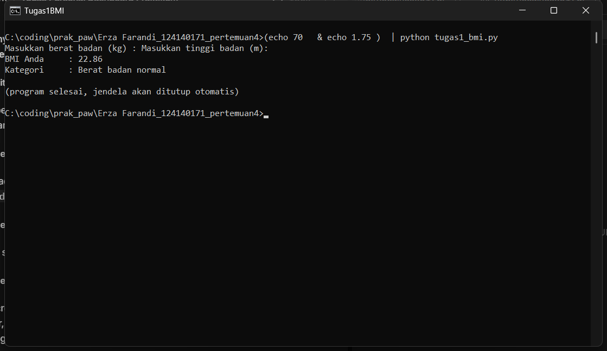
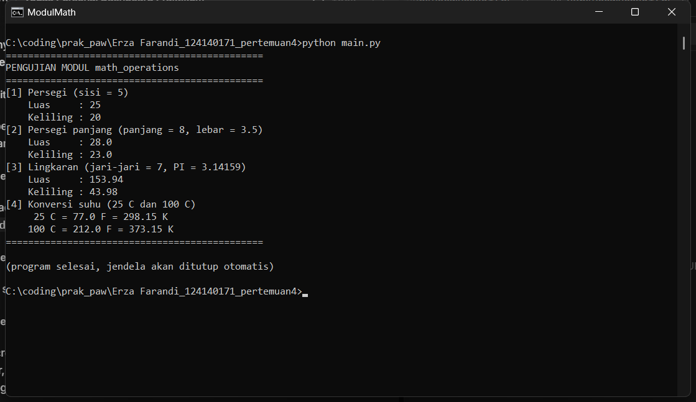

# Tugas Praktikum PAW Pertemuan 4 — Dasar Pemrograman Python

Nama: Erza Farandi NIM: 124140171 Praktikum Pengembangan Aplikasi Web — Pertemuan 4 (Python)

## Deskripsi aplikasi

Tugas praktikum Pertemuan 4 berisi tiga program Python yang menguji pemahaman variabel, struktur kendali (`if-else` dan loop), fungsi, struktur data koleksi (list & dictionary), dan pembuatan modul kustom.

### 1. `tugas1_bmi.py` — Penghitung BMI Sederhana

Meminta berat badan (kg) dan tinggi badan (m) lewat `input()`, menghitung `BMI = berat / (tinggi * tinggi)`, lalu menentukan kategori berat badan dengan percabangan `if-elif-else` empat kategori: berat kurang (< 18.5), normal (18.5–24.9), berlebih (25–29.9), dan obesitas (≥ 30). Nilai BMI dicetak 2 angka desimal dengan f-string.

### 2. `tugas2_nilai_mahasiswa.py` — Pengelolaan Data Nilai Mahasiswa

Memuat list berisi 5 dictionary mahasiswa (kunci `nama`, `nim`, `nilai_uts`, `nilai_uas`, `nilai_tugas`). Fungsi `hitung_nilai_akhir()` menghitung nilai akhir dengan bobot 30% UTS + 40% UAS + 30% tugas, fungsi `tentukan_grade()` menentukan grade A–E lewat `if-elif-else`. Hasilnya ditampilkan sebagai tabel rapi (Nama, NIM, Nilai Akhir, Grade) memakai perataan f-string, kemudian loop sederhana mencari mahasiswa bernilai akhir tertinggi dan terendah.

### 3. `math_operations.py` + `main.py` — Modul Matematika Kustom

`math_operations.py` adalah modul kustom yang memuat:

- konstanta `PI = 3.14159`,
- luas & keliling 3 bentuk geometri: **persegi**, **persegi panjang**, dan **lingkaran**,
- 2 fungsi konversi suhu: **Celsius → Fahrenheit** dan **Celsius → Kelvin**,
- docstring pada setiap fungsi (menjelaskan parameter input dan nilai kembalian).

`main.py` mengimpor dan memakai seluruh fungsi tersebut dengan 2 cara berbeda:
`import math_operations as mo` (akses lewat nama modul) dan `from math_operations import PI, celsius_ke_fahrenheit, celsius_ke_kelvin` (impor langsung nama), lalu menampilkan hasil pengujian tiap fungsi dengan format rapi.

## Cara menjalankan

1. Buka folder `Erza Farandi_124140171_pertemuan4` di terminal (VS Code / cmd)
2. Jalankan per berkas:

```
python tugas1_bmi.py
```

lalu isi berat (contoh: 70) dan tinggi (contoh: 1.75) saat diminta. Soal 2 dan 3 langsung berjalan:

```
python tugas2_nilai_mahasiswa.py
python main.py
```

## Struktur folder

```
tugas1_bmi.py              # Soal 1: penghitung BMI
tugas2_nilai_mahasiswa.py  # Soal 2: data nilai mahasiswa (list of dict)
math_operations.py         # Soal 3A: modul matematika
main.py                    # Soal 3B: program utama pemanggil modul
screenshots/               # bukti hasil eksekusi di terminal
README.md / .gitignore
```

## Screenshot hasil eksekusi

### Soal 1 — Program Penghitung BMI

BMI 70 kg / 1.75 m = 22.86 → kategori berat badan normal:



### Soal 2 — Pengelolaan Data Nilai Mahasiswa

Tabel 5 mahasiswa dengan grade A–E, plus mahasiswa nilai tertinggi & terendah:


### Soal 3 — Modul Matematika & Program Utama

Luas/keliling persegi, persegi panjang, lingkaran, dan konversi suhu dari `main.py`:



## Catatan kode

- Setiap fungsi diberi docstring dengan penjelasan parameter (Args) dan nilai kembalian (Returns).
- Kode mengikuti PEP 8: indentasi 4 spasi konsisten, penamaan snake_case, konstanta ditulis HURUF_KAPITAL.
- Berkas hasil kompilasi `__pycache__/` tidak ikut tersimpan (ada di `.gitignore`).
