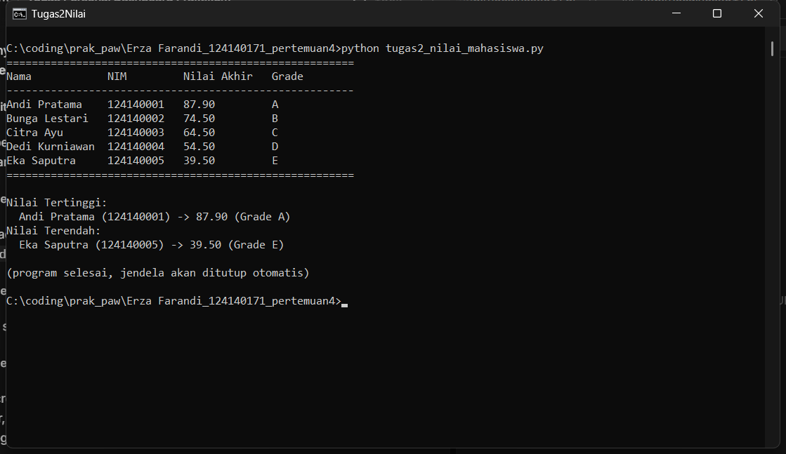

# Tugas Praktikum PAW Pertemuan 4 — Dasar Pemrograman Python

Nama: Erza Farandi NIM: 124140171 Praktikum Pengembangan Aplikasi Web — Pertemuan 4 (Python)

## Deskripsi aplikasi

Tugas praktikum Pertemuan 4 berisi tiga program Python:

- `tugas1_bmi.py` — menghitung BMI dari berat (kg) dan tinggi (m) yang diminta dari pengguna, lalu menentukan kategori berat badannya: kurang, normal, berlebih, atau obesitas.
- `tugas2_nilai_mahasiswa.py` — memproses data 7 mahasiswa: menghitung nilai akhir (30% UTS + 40% UAS + 30% tugas), menentukan grade A–E, menampilkannya dalam tabel yang rapi, dan mencari nilai tertinggi & terendah.
- `math_operations.py` + `main.py` — fungsi untuk menghitung luas & keliling persegi, persegi panjang, dan lingkaran (dengan konstanta `PI`), serta mengonversi suhu Celsius→Fahrenheit dan Celsius→Kelvin; `main.py` memanggil seluruh fungsinya dengan 2 cara impor berbeda.

## Cara menjalankan

1. Buka folder ini di terminal (VS Code / cmd)
2. Jalankan per berkas:

```
python tugas1_bmi.py
```

lalu isi berat (contoh: 70) dan tinggi (contoh: 1.75) saat diminta. Soal 2 dan 3 langsung berjalan:

```
python tugas2_nilai_mahasiswa.py
python main.py
```

## Screenshot hasil eksekusi

### Soal 1 — Program Penghitung BMI


### Soal 2 — Pengelolaan Data Nilai Mahasiswa



### Soal 3 — Modul Matematika & Program Utama


