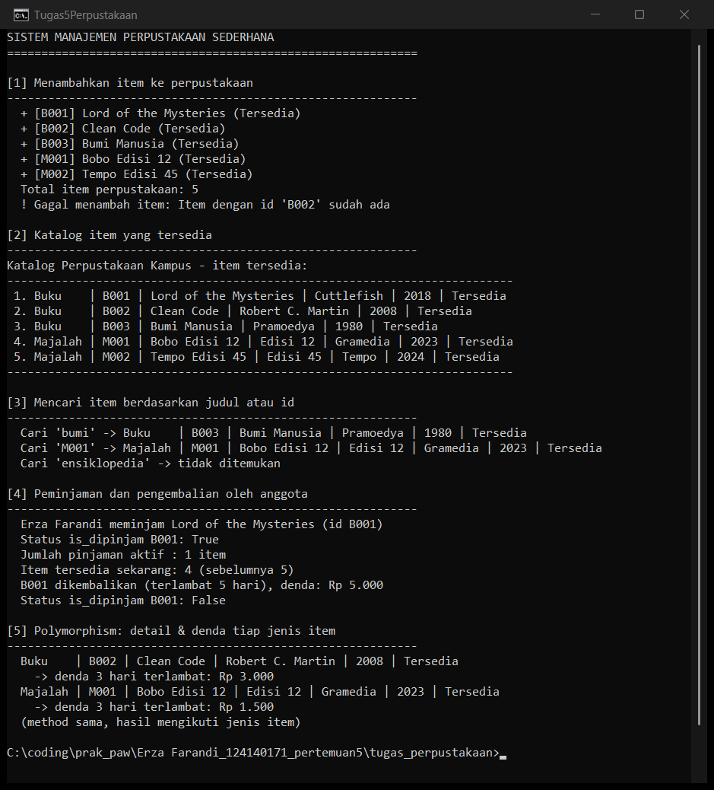

# Sistem Manajemen Perpustakaan Sederhana — Praktikum PAW Pertemuan 5

- **Nama Lengkap:** Erza Farandi
- **NIM:** 124140171
- **Kelas Praktikum:** RB

## Deskripsi program

Program simulasi perpustakaan yang dibangun dengan OOP Python. Saat dijalankan, `main.py` membuat objek perpustakaan lalu:

1. menambahkan 3 buku dan 2 majalah ke koleksi (termasuk contoh penolakan id ganda),
2. menampilkan katalog item yang tersedia,
3. mencari item berdasarkan judul (sebagian) atau id,
4. meminjam dan mengembalikan item oleh seorang anggota, lengkap dengan perhitungan denda keterlambatan,
5. menampilkan detail dan denda tiap jenis item lewat satu method yang sama.

## Penerapan 4 pilar OOP

**1. Class & Object**
Semua data dibungkus dalam class: `LibraryItem` (dasar), `Book`, `Magazine`, `Library`, dan `Member`. Objek dibuat dari class tersebut, misalnya `Book("B001", "Lord of the Mysteries", 2018, "Cuttlefish")`.

**2. Inheritance**
`LibraryItem` adalah abstract class (`ABC`) dengan method abstract `get_detail()` dan `hitung_denda()`. `Book` dan `Magazine` mewarisi `LibraryItem` dan wajib mengimplementasikan kedua method tersebut.

**3. Encapsulation**
Atribut penting dilindungi: `__koleksi` (private) pada `Library`, `__dipinjam` (private) pada `LibraryItem`, `__id_anggota`/`__nama`/`__pinjaman` (private) pada `Member`, serta `_judul`, `_tahun_terbit`, `_penulis` (protected). Akses dari luar hanya lewat property seperti `judul`, `is_dipinjam`, `koleksi`, dan `daftar_pinjaman`; perubahan status hanya bisa lewat method `tambah_item()`, `pinjam_item()`, dan `kembalikan_item()` yang memvalidasi input.

**4. Polymorphism**
`get_detail()` dan `hitung_denda()` dipanggil lewat referensi `LibraryItem`, tetapi hasilnya menyesuaikan jenis item: denda buku Rp 1.000/hari dan majalah Rp 500/hari, dengan format detail yang berbeda.

## Cara menjalankan program

1. Buka terminal, lalu jalankan:

```
python main.py
```

## Screenshot output

Hasil eksekusi `python main.py`: penambahan item, katalog, pencarian, peminjaman/pengembalian, dan polymorphism.


