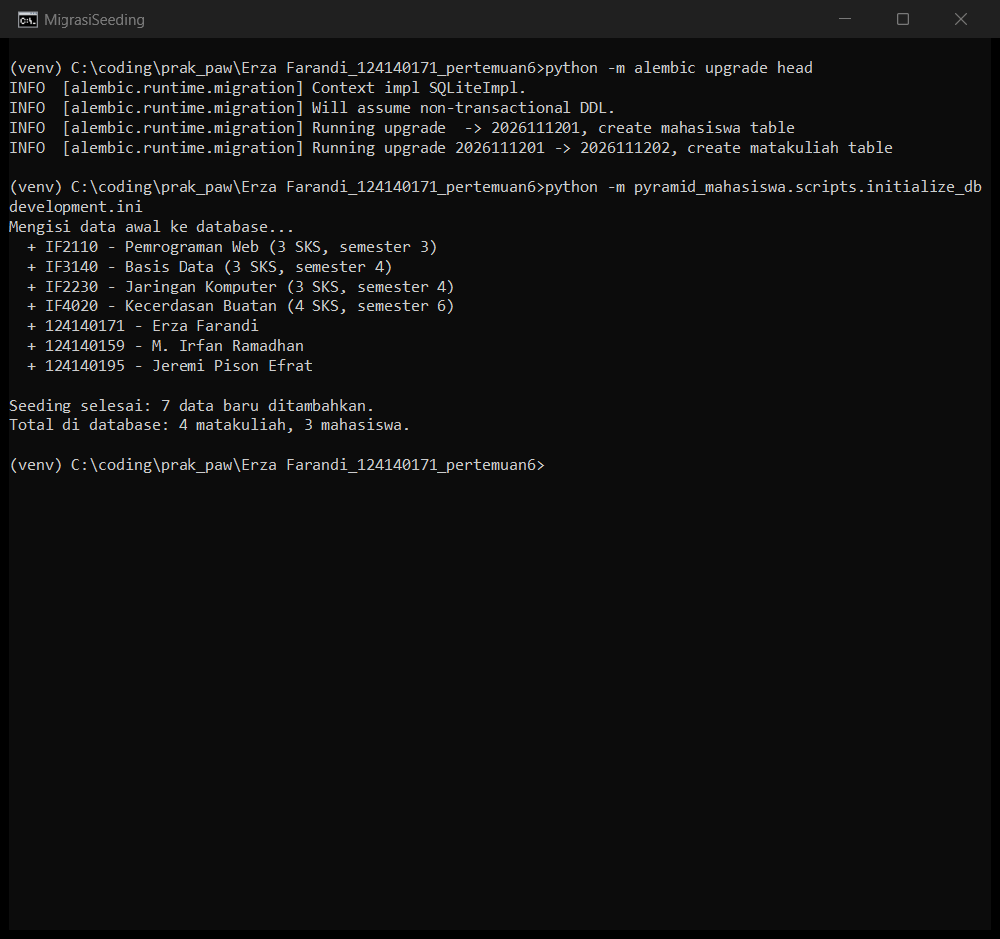
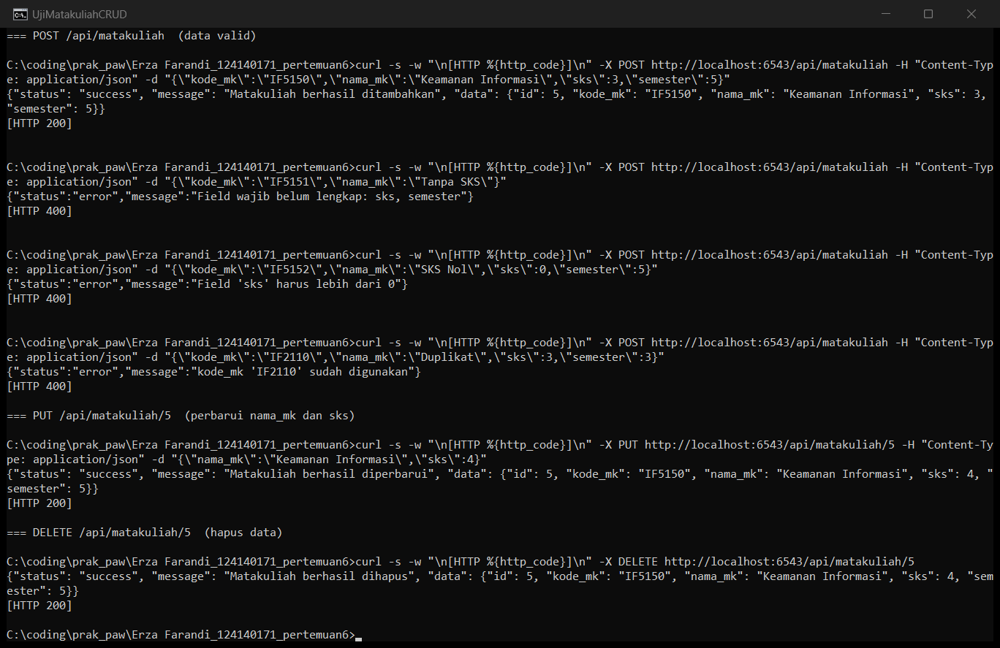

# RESTful API Manajemen Matakuliah — Praktikum PAW Pertemuan 6

- **Nama Lengkap:** Erza Farandi
- **NIM:** 124140171
- **Kelas Praktikum:** RB

## Deskripsi aplikasi

Aplikasi web **Pyramid** yang menyediakan RESTful API untuk mengelola data
**mahasiswa** dan **matakuliah**. Setiap endpoint mengembalikan JSON dan
menerapkan status code yang sesuai (`200`, `400`, `404`).

Aplikasi dibangun dengan konsep yang dipelajari pada praktikum:

- **Model data ORM** (SQLAlchemy) untuk tabel `mahasiswa` dan `matakuliah`,
- **Migrasi Alembic** untuk membuat dan mengubah struktur tabel,
- **URL dispatch** pada `routes.py` dengan predikat `request_method`,
- **View controller CRUD** pada folder `views/`.

`development.ini` memakai database **SQLite** lokal agar mudah dijalankan,
sedangkan `production.ini` sudah disiapkan untuk **PostgreSQL**.

## Struktur direktori

```
Erza Farandi_124140171_pertemuan6/
├── development.ini
├── production.ini
├── setup.py
├── alembic.ini
├── README.md
├── .gitignore
├── screenshots/
└── pyramid_mahasiswa/
    ├── __init__.py
    ├── routes.py
    ├── alembic/
    │   ├── env.py
    │   └── versions/
    │       ├── 20261112_create_mahasiswa_table.py
    │       └── 20261112_create_matakuliah_table.py
    ├── models/
    │   ├── __init__.py
    │   ├── meta.py
    │   ├── mahasiswa.py
    │   └── matakuliah.py
    ├── scripts/
    │   ├── __init__.py
    │   └── initialize_db.py
    └── views/
        ├── __init__.py
        ├── default.py
        ├── mahasiswa.py
        └── matakuliah.py
```

## Instalasi

```bash
python -m venv venv
venv\Scripts\activate
pip install -e .
```

Pada Linux/macOS, aktifkan virtual environment dengan
`source venv/bin/activate`.

## Migrasi database

Berkas `pyramid_mahasiswa/alembic/env.py` membaca `sqlalchemy.url` dari
`development.ini`, jadi cukup jalankan:

```bash
alembic upgrade head
```

Perintah tersebut menjalankan dua revisi:

1. `20261112_create_mahasiswa_table.py`
2. `20261112_create_matakuliah_table.py`

## Mengisi data awal (seeding)

```bash
initialize_db development.ini
```

Alternatif jika entry point belum terpasang:

```bash
python -m pyramid_mahasiswa.scripts.initialize_db development.ini
```

Data awal yang dimasukkan: 3 mahasiswa dan 4 matakuliah
(IF2110, IF3140, IF2230, IF4020).

## Menjalankan server

```bash
pserve --reload development.ini
```

Server berjalan di `http://localhost:6543`.

## Endpoint API

| Method | URL | Keterangan |
|---|---|---|
| GET | `/api/mahasiswa` | Daftar seluruh mahasiswa |
| GET | `/api/mahasiswa/{id}` | Detail mahasiswa (404 jika tidak ada) |
| POST | `/api/mahasiswa` | Tambah mahasiswa (400 jika tidak valid) |
| PUT | `/api/mahasiswa/{id}` | Perbarui mahasiswa |
| DELETE | `/api/mahasiswa/{id}` | Hapus mahasiswa |
| GET | `/api/matakuliah` | Daftar seluruh matakuliah |
| GET | `/api/matakuliah/{id}` | Detail matakuliah (404 jika tidak ada) |
| POST | `/api/matakuliah` | Tambah matakuliah (400 jika tidak valid) |
| PUT | `/api/matakuliah/{id}` | Perbarui matakuliah |
| DELETE | `/api/matakuliah/{id}` | Hapus matakuliah |

Field wajib matakuliah: `kode_mk`, `nama_mk`, `sks`, `semester`.
Nilai `sks` dan `semester` harus bilangan bulat lebih dari 0.

## Contoh pengujian dengan cURL

```bash
curl http://localhost:6543/api/matakuliah
```

```bash
curl -X POST http://localhost:6543/api/matakuliah \
  -H "Content-Type: application/json" \
  -d "{\"kode_mk\":\"IF5150\",\"nama_mk\":\"Keamanan Informasi\",\"sks\":3,\"semester\":5}"
```

```bash
curl -X PUT http://localhost:6543/api/matakuliah/5 \
  -H "Content-Type: application/json" -d "{\"sks\":4}"
```

```bash
curl -X DELETE http://localhost:6543/api/matakuliah/5
```

## Screenshot hasil pengujian

### Migrasi Alembic dan seeding data awal



### GET /api/matakuliah dan GET /api/matakuliah/{id}

Daftar seluruh matakuliah, detail id 2, dan respons 404 untuk id yang
tidak ada.


### POST, PUT, DELETE /api/matakuliah

Penambahan data valid, validasi field wajib, validasi `sks` nol,
kode duplikat, pembaruan, dan penghapusan.



### CRUD /api/mahasiswa

Pengujian seluruh endpoint mahasiswa (GET, POST, PUT, DELETE).


## Catatan PostgreSQL

Untuk memakai PostgreSQL:

1. Buat database, misalnya `CREATE DATABASE pyramid_mahasiswa;`
2. Sesuaikan `sqlalchemy.url` pada `production.ini`.
3. Jalankan migrasi dengan konfigurasi produksi, lalu server:

```bash
set PYRAMID_CONFIG=production.ini
alembic upgrade head
pserve production.ini
```

Pada Linux/macOS gunakan
`PYRAMID_CONFIG=production.ini alembic upgrade head`.

Direktori `venv/`, berkas `*.sqlite`, dan `__pycache__/` sudah dikecualikan
melalui `.gitignore` sehingga tidak ikut diunggah ke GitHub.
