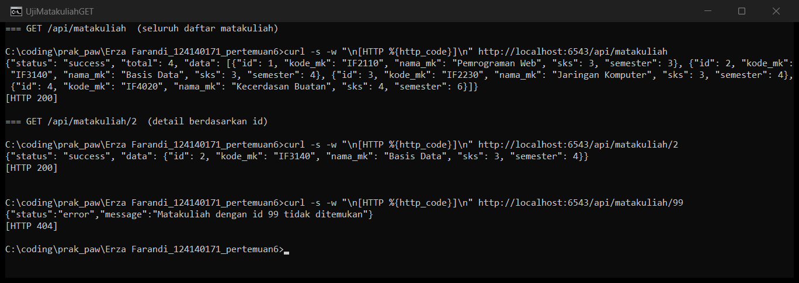
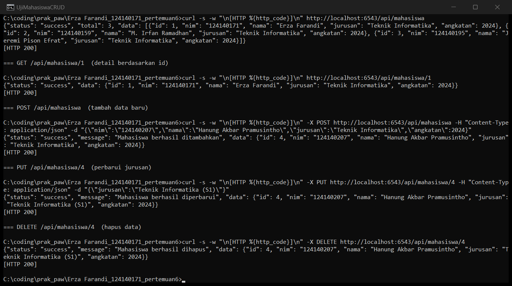

# RESTful API Manajemen Matakuliah — Pyramid

**Erza Farandi** · NIM **124140171** · Kelas Praktikum **RB**

Aplikasi web Pyramid untuk mengelola data mahasiswa dan mata kuliah.
Setiap endpoint mengembalikan JSON. Data disimpan melalui SQLAlchemy ORM,
tabel dibuat lewat migrasi Alembic, dan URL didaftarkan dengan URL dispatch
beserta predikat `request_method`.

Fitur:

- CRUD mahasiswa (modul praktikum) dan CRUD mata kuliah (tugas).
- Tabel dibuat lewat migrasi Alembic, data awal diisi lewat script seeding.
- Validasi data mata kuliah: semua field wajib diisi, `sks` dan `semester`
  harus bilangan bulat lebih dari 0, `kode_mk` tidak boleh sama.
- Status code sesuai hasil: `200` berhasil, `400` data tidak valid,
  `404` data tidak ditemukan.

Endpoint:

| Method | URL | Keterangan |
|---|---|---|
| GET | `/api/mahasiswa` | Semua mahasiswa |
| GET | `/api/mahasiswa/{id}` | Detail mahasiswa |
| POST | `/api/mahasiswa` | Tambah mahasiswa |
| PUT | `/api/mahasiswa/{id}` | Ubah mahasiswa |
| DELETE | `/api/mahasiswa/{id}` | Hapus mahasiswa |
| GET | `/api/matakuliah` | Semua mata kuliah |
| GET | `/api/matakuliah/{id}` | Detail mata kuliah |
| POST | `/api/matakuliah` | Tambah mata kuliah |
| PUT | `/api/matakuliah/{id}` | Ubah mata kuliah |
| DELETE | `/api/matakuliah/{id}` | Hapus mata kuliah |

## Cara menjalankan

1. Siapkan database. Secara bawaan `development.ini` memakai SQLite, jadi
   tidak ada yang perlu disiapkan. Bila ingin memakai PostgreSQL (seperti
   pada `production.ini`), buat database dan user lewat
   `psql -U postgres -h localhost`:

```sql
CREATE DATABASE pyramid_mahasiswa;
CREATE USER pyramid_user WITH ENCRYPTED PASSWORD 'pyramid_pass';
GRANT ALL PRIVILEGES ON DATABASE pyramid_mahasiswa TO pyramid_user;
\c pyramid_mahasiswa
GRANT ALL ON SCHEMA public TO pyramid_user;
```

2. Buka folder ini di VS Code, lalu di terminal buat virtual environment
   dan install proyek:

```bash
python -m venv venv
venv\Scripts\activate
pip install -e .
```

3. Terapkan migrasi sekaligus isi data awal (satu perintah):

```bash
python -m pyramid_mahasiswa.scripts.initialize_db development.ini
```

Perintah ini menjalankan `alembic upgrade head` dari dalam script, lalu
mengisi 3 mahasiswa dan 4 mata kuliah. Aman diulang karena data yang sudah
ada akan dilewati.

4. Jalankan server:

```bash
pserve development.ini --reload
```

Server jalan di `http://localhost:6543`.

Untuk PostgreSQL, cukup ganti nama berkasnya:

```bash
python -m pyramid_mahasiswa.scripts.initialize_db production.ini
pserve production.ini
```

## Pengujian

Pengujian memakai cURL di terminal kedua selagi server berjalan. Di
PowerShell gunakan `curl.exe` (bukan `curl`) agar hasilnya sesuai.

```bash
curl.exe -i http://localhost:6543/api/matakuliah
curl.exe -i http://localhost:6543/api/matakuliah/1
curl.exe -i -X POST http://localhost:6543/api/matakuliah -H "Content-Type: application/json" -d "{\"kode_mk\":\"IF5150\",\"nama_mk\":\"Keamanan Informasi\",\"sks\":3,\"semester\":5}"
curl.exe -i -X PUT http://localhost:6543/api/matakuliah/5 -H "Content-Type: application/json" -d "{\"sks\":4}"
curl.exe -i -X DELETE http://localhost:6543/api/matakuliah/5
```

Endpoint mahasiswa diuji dengan cara yang sama lewat `/api/mahasiswa`.
Respons `400` bisa dicoba dengan mengosongkan salah satu field wajib atau
mengirim `sks` bernilai 0.

## Screenshot

### Matakuliah — GET semua & GET detail

Daftar seluruh mata kuliah, detail berdasarkan id, dan respons `404` saat
id tidak ditemukan.



### Matakuliah — POST, validasi (400), PUT & DELETE

Penambahan data valid, tiga contoh data tidak valid, pembaruan, dan
penghapusan data.


### Mahasiswa — GET, POST, PUT & DELETE

Pengujian seluruh endpoint mahasiswa, mulai dari daftar, detail,
penambahan, pembaruan, sampai penghapusan.



## Materi Pyramid yang dipakai

| Materi | File |
|---|---|
| Model ORM + `to_dict()` | `models/mahasiswa.py`, `models/matakuliah.py` |
| Registrasi model | `models/__init__.py` |
| Migrasi Alembic | `alembic/versions/20261112_create_mahasiswa_table.py`, `20261112_create_matakuliah_table.py` |
| Seeding data awal | `scripts/initialize_db.py` (3 mahasiswa, 4 mata kuliah) |
| View CRUD | `views/mahasiswa.py`, `views/matakuliah.py` |
| URL Dispatch + `request_method` | `routes.py` |
| Koneksi database | `development.ini`, `production.ini` |
